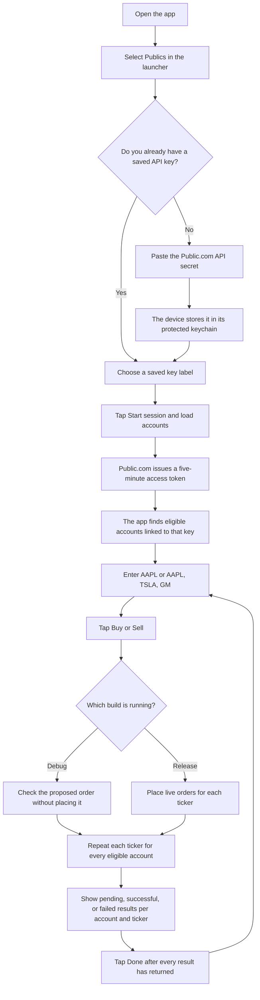

# Publics Trading Interface

Publics Trading Interface is a desktop and mobile multi-applet app. Its **Publics** applet places stock orders across eligible Public.com accounts connected to one selected API key or all saved keys in Auto Mode. The **Robin Hood** launcher option is disabled until that applet exists.

The app is intended for people who manage more than one supported Public.com brokerage account and want to see the result for each account in one place.

> [!CAUTION]
> A Release build places real market orders. In the standard workspace, Buy or Sell reaches every eligible account for the selected key; in Auto Mode, it reaches every eligible account across **all saved keys**. There is no final confirmation screen. Debug builds use Public.com's preflight check instead and do not place the order.

## What the app does

| Function | What it means for the user |
| --- | --- |
| Stores API keys securely | You paste a Public.com API secret once. The secret is saved in the device's protected keychain rather than displayed in the app. |
| Supports more than one API key | Saved keys use stable labels such as `PublicsApiKey0` and `PublicsApiKey1`. Tap the pencil inside a key row to set a display nickname; leave it blank to restore the default name. Tap the trash button and confirm to delete the key and its nickname. Selection and keychain retrieval still use the original label. |
| Starts a short session | The selected key is exchanged for a Public.com access token that lasts five minutes. Trading controls appear only after the session starts. |
| Finds connected accounts | The app loads the eligible accounts connected to the selected key. It supports standard brokerage, Roth IRA, traditional IRA, and business (`ENTITY`) accounts. |
| Sends orders to every eligible account | Enter one ticker (`AAPL`) or a comma-separated list (`AAPL, TSLA, GM`). Buy requests one share of each ticker per account; Sell All requests that account's full held balance for each ticker. |
| Shows every account/ticker result | A results screen lists each account and ticker as waiting, successful, or failed. Public.com's response or error is shown for each request. |
| Handles slow requests | If Public.com does not return an order result within 30 seconds, that account is marked as failed. |
| Lets you switch keys | You can end the current session, return to the saved-key list, and start another session with a different key. |
| Auto Mode | Open it from the bottom of the main menu to trade across every saved key without selecting one. The screen lists key labels, authenticates each key on submission, and shows results for each eligible account. |
| Adapts to different screen sizes | The interface rearranges itself for phones, tablets, and desktop windows. |

Open the app and select **Publics** in the launcher. Both launcher choices use the same neutral button style, with a dark-blue stripe for Publics and a lime-green stripe for Robin Hood. **← Applets** returns to the launcher after outstanding key operations/trades finish; leaving clears the Publics session. No additional application window is created.

## How a session flows

The same flow as a short list:

1. Select Publics, then save or select a Public.com API key.
2. Start a five-minute session.
3. Wait while the app loads the supported accounts connected to that key.
4. Type a ticker or comma-separated tickers (for example, `AAPL, TSLA, GM`). Spaces, numbers, and punctuation other than the separating comma are ignored; empty entries, including a trailing comma, are skipped.
5. Tap Buy or Sell.
6. Review the result for every account and ticker.
7. Tap Done to return to the trading screen, or switch keys to start a different session.

Auto Mode is an alternative to steps 1–3: save keys in the main menu, select Auto Mode, enter tickers, then Buy or Sell All. For each key in order, the app loads the saved secret, obtains its own authorization token, and finds its eligible accounts. For each account it processes the tickers in entered order, waiting for each response and then 100 ms before the next ticker. It finishes that account before moving to the next one. It closes the key's session after all account/ticker results and waits **3 seconds after session closure** before starting the next key. Sell All uses each account's held balance for each ticker; a missing holding shows a failure/no-order row. Key loading, authorization, or account-loading failures appear under that key's label, and processing continues with the other keys after the same pause.

## Order details

Every submitted order currently uses these fixed settings:

- One share of each ticker for Buy; the account's full held balance of each ticker for Sell All
- Stock/equity
- Market order
- Day order, which expires at the end of the trading day if it does not fill
- Order validation enabled
- All eligible accounts linked to the selected API key (standard mode), or all saved API keys (Auto Mode)

The app does not currently offer a quantity selector, limit prices, stop orders, extended-hours settings, or a way to choose only some of the loaded accounts.

## Supported account types

The app includes these Public.com account types when it prepares an order:

- Standard brokerage
- Roth IRA
- Traditional IRA
- Business (`ENTITY`)

Other account types are skipped.

## Debug and Release behavior

| Build | Buy button | Sell button |
| --- | --- | --- |
| Debug | Runs a preflight check only | Runs a preflight check only |
| Release | Places a live market order | Places a live market order |

A preflight asks Public.com whether an order would be accepted and can return an estimated value and fee. It does not place the order.

## Security and privacy

- API secrets are stored in the operating system's protected keychain.
- The app shows key labels after saving, not the secret values. The label list is also kept in the protected keychain so an update or reinstall can find the saved credentials again.
- Display nicknames are stored separately by original key label in QSettings; they do not rename or move keychain credentials. QSettings data may not survive uninstall/reinstall even if the OS keychain retains the secrets.
- Existing labels from older versions are migrated automatically the first time the updated app is opened. Persistence requires the same signing team and bundle identifier.
- Insecure keychain fallback is disabled.
- Switching keys clears the previous account list and authorization state before the new session begins.
- The app talks directly to Public.com's API over HTTPS.

Never share an API key, screenshot it, or commit it to this repository.

## What the results screen means

Each loaded account and entered ticker gets its own result row:

- `Pending` means the app is waiting for Public.com.
- `Trade success` means Public.com accepted the preflight or live order request.
- `Trade failed` means Public.com rejected the request, a network error occurred, or the request timed out.

The Done button stays disabled until every account/ticker request has either succeeded or failed. Read every row before leaving the results screen.

## Current limitations

- Tickers are entered manually, including comma-separated lists. There is no autocomplete or instrument-search request.
- The app does not display balances, positions, buying power, or the number of shares available to sell.
- Saved API key nicknames can be edited. Deleting a key requires confirmation and removes its keychain credential, saved label, and nickname; underlying keychain labels cannot be renamed.
- The five-minute countdown is maintained by the app and does not renew the session automatically.
- A Release order is sent as soon as Buy or Sell is pressed. There is no extra confirmation step.
- Successful submission means Public.com accepted the request. It does not guarantee that the market order has filled.

## Intended platforms

The project uses Qt 6 and is set up for macOS, iOS, Android, and Windows. Platform support still depends on having the required Qt tools, signing setup, and device permissions for the target system.

## Development

Source layout, build/test commands, safety boundaries, and icon ownership are documented in `docs/development.md`.

## Disclaimer

This project is an independent trading interface and is not financial advice. Review the source, test with a Debug build, and understand the account-wide behavior before using a Release build. You are responsible for every order sent through your Public.com account.
